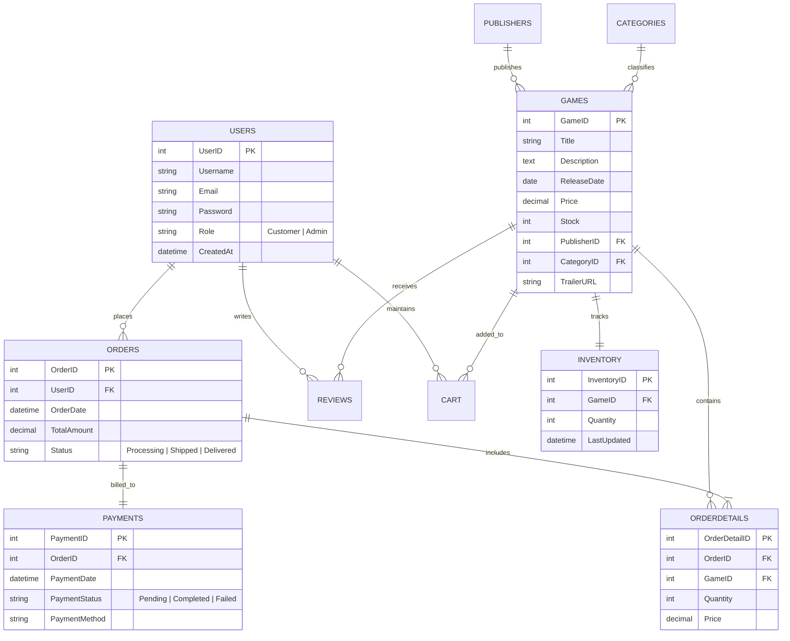

# JayZee E-Store: Relational Game Store & Database Management System

[](https://www.php.net/)
[](https://www.mysql.com/)
[](https://getbootstrap.com/)
[](https://developer.mozilla.org/en-US/docs/Web/JavaScript)
[](https://www.apachefriends.org/)
[](https://opensource.org/licenses/MIT)

**JayZee E-Store** is a comprehensive, full-stack e-commerce platform and relational Database Management System (DBMS) designed for video game cataloging, inventory lifecycle tracking, and digital retail. Engineered with a normalized MySQL database backend, an asynchronous AJAX storefront, and a role-guarded administrative suite.

---

## Relational Database Architecture (ERD)

The system is architected around a 3rd Normal Form (3NF) relational schema comprising 10 interconnected entities ensuring referential integrity and zero redundancy across users, inventory, orders, and payments:



---

## Core Functional Modules

### 1. Interactive Storefront & Live AJAX Search
- **Multi-Table Joined Catalog:** Surfaces titles enriched with publisher metadata, genre categories, and real-time stock availability.
- **Asynchronous Search (`search.php`):** Debounced client-side queries querying SQL backend without full-page reloads.
- **Categorical & Price Filtering:** Instant client/server-side filtering across genres (Action, RPG, Strategy, Indie) and price brackets.

### 2. Product Showcase & Media Engagement
- **Embedded Video Trailers:** High-definition video trailer playback integrated directly into individual game showcase pages.
- **1–5 Star Rating & Review Engine:** Customer feedback pipeline enforcing database-level rating constraints (`1 <= Rating <= 5`) and timestamps.

### 3. Shopping Cart & Transaction Pipeline
- **Stateful Shopping Cart (`cart.php`):** User-specific cart state tracking with atomic add, quantity adjustment, and removal actions.
- **Checkout & Order Fulfillment:** Generates immutable transaction snapshots (`orders` and `orderdetails`), linking simulated payment records with status auditing.
- **Stock Validation:** Real-time quantity checks against the `inventory` table to prevent overselling.

### 4. Administrative Inventory & Order Management
- **Role-Based Access Control (RBAC):** Strict session validation ensuring only accounts with `Role = 'Admin'` access backend management suites.
- **Live Inventory Restocking (`admin_inventory.php`):** Direct stock replenishment updates synchronized between `games` and `inventory` records.
- **Fulfillment Lifecycle Controller:** Updates order progression through discrete states (`Processing` $\to$ `Shipped` $\to$ `Delivered`).

### 5. Authentication & Security
- **Secure Password Hashing:** User passwords hashed using standard PHP `password_hash()` with `PASSWORD_DEFAULT` (Bcrypt) and validated via `password_verify()`.
- **Injection Mitigation:** Sanitized request parameters and prepared statements across transactional endpoints.

---

## Database Entity Reference

| Table | Primary Key | Foreign Keys | Purpose |
| :--- | :--- | :--- | :--- |
| `users` | `UserID` | — | Customer and Admin credentials, roles, and profiles |
| `categories` | `CategoryID` | — | Game genres and classifications |
| `publishers` | `PublisherID` | — | Game publishers and studio metadata |
| `games` | `GameID` | `PublisherID`, `CategoryID` | Core product catalog, pricing, and trailers |
| `inventory` | `InventoryID` | `GameID` | Granular stock tracking and update timestamps |
| `cart` | `CartID` | `UserID`, `GameID` | Active and historical user shopping carts |
| `orders` | `OrderID` | `UserID` | High-level customer order transactions and status |
| `orderdetails` | `OrderDetailID` | `OrderID`, `GameID` | Line-item pricing, quantities, and purchased games |
| `payments` | `PaymentID` | `OrderID` | Payment settlement records and methods |
| `reviews` | `ReviewID` | `UserID`, `GameID` | Customer ratings (1–5) and commentary |

---

## Repository Structure

```text
jayzee-game-store-dbms/
├── assets/
│   ├── css/
│   │   └── styles.css          # Core dark-mode theme, glassmorphic cards, animations
│   ├── js/
│   │   └── scripts.js          # Dynamic UI interactions & AJAX category filters
│   ├── images/
│   │   ├── games/              # Game cover imagery library
│   │   └── ui/                 # Brand logos, icons, and UI assets
│   └── videos/
│       └── home.mp4            # Hero background ambient video
├── database/
│   └── tables/                 # Individual relational table schemas & mock datasets
│       ├── users.sql
│       ├── categories.sql
│       ├── publishers.sql
│       ├── games.sql
│       ├── inventory.sql
│       ├── cart.sql
│       ├── orders.sql
│       ├── orderdetails.sql
│       ├── payments.sql
│       └── reviews.sql
├── includes/
│   └── db_connect.php          # Database connection abstraction using MySQLi
├── tools/
│   └── hash_password.php       # Password hashing utility script
├── admin_inventory.php         # Admin control panel for inventory & orders
├── cart.php                    # User shopping cart interface
├── home.php                    # Primary storefront & catalog page
├── index.php                   # Entry point routing to home or auth
├── login.php                   # Authentication portal
├── orders.php                  # User past order history overview
├── order_confirmation.php      # Receipt summary for completed orders
├── order_details.php           # Granular order breakdown
├── order_summary.php           # Pre-checkout transaction review
├── product.php                 # Detailed game overview, trailer, and reviews
├── register.php                # Account registration
├── search.php                  # Asynchronous search API endpoint
└── README.md                   # System documentation
```

---

## Getting Started

### Prerequisites
- [XAMPP](https://www.apachefriends.org/) (recommended), WampServer, or any standard LAMP/LEMP stack with **PHP 7.4+** and **MySQL 8.0+ / MariaDB**.
- A modern web browser.

---

### Step-by-Step Installation

#### 1. Clone the Repository
Clone the project into your local web server root directory:

```bash
# For XAMPP on Windows:
cd C:/xampp/htdocs
git clone https://github.com/abdullahej5411/jayzee-game-store-dbms.git
```

#### 2. Import Database Schema
1. Start the **Apache** and **MySQL** modules in the XAMPP Control Panel.
2. Open **phpMyAdmin** in your browser at `http://localhost/phpmyadmin`.
3. Create a new database named:
   ```sql
   CREATE DATABASE gamestoredb;
   ```
4. Navigate to the `gamestoredb` database and import the SQL files located in `database/tables/` in the following dependency order:
   1. `users.sql`
   2. `categories.sql`
   3. `publishers.sql`
   4. `games.sql`
   5. `inventory.sql`
   6. `cart.sql`
   7. `orders.sql`
   8. `orderdetails.sql`
   9. `payments.sql`
   10. `reviews.sql`

#### 3. Configure Database Connection
Verify the credentials in `includes/db_connect.php`:

```php
$servername = "localhost";
$username = "root";
$password = "";
$dbname = "gamestoredb";

$conn = new mysqli($servername, $username, $password, $dbname);

if ($conn->connect_error) {
    die("Connection failed: " . $conn->connect_error);
}
```

#### 4. Launch Application
Open your browser and navigate to:
```text
http://localhost/jayzee-game-store-dbms/
```

---

## License

This project is open-source and available under the [MIT License](LICENSE).
